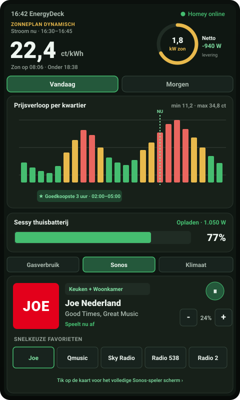
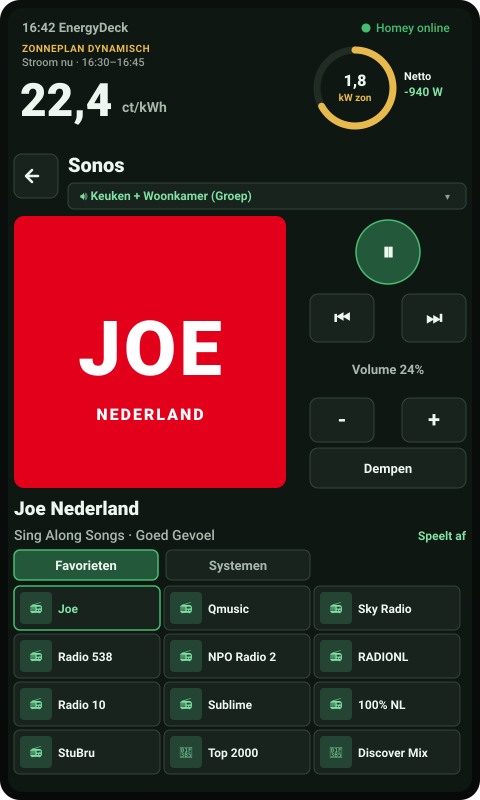
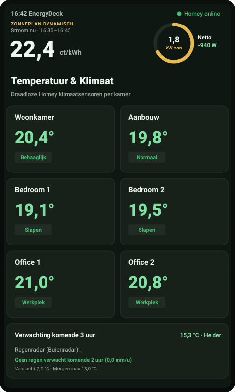
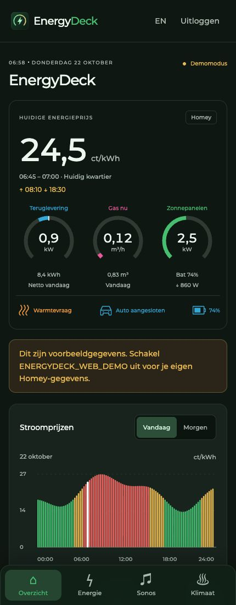
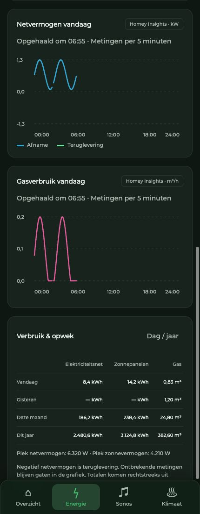
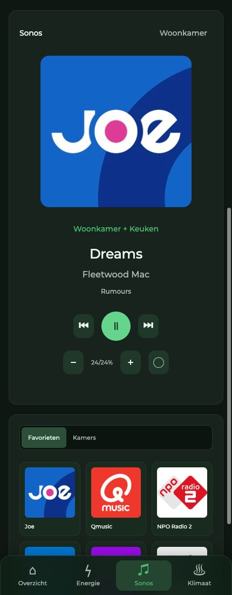
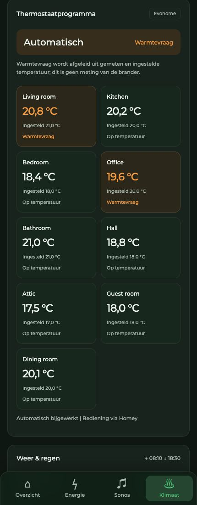
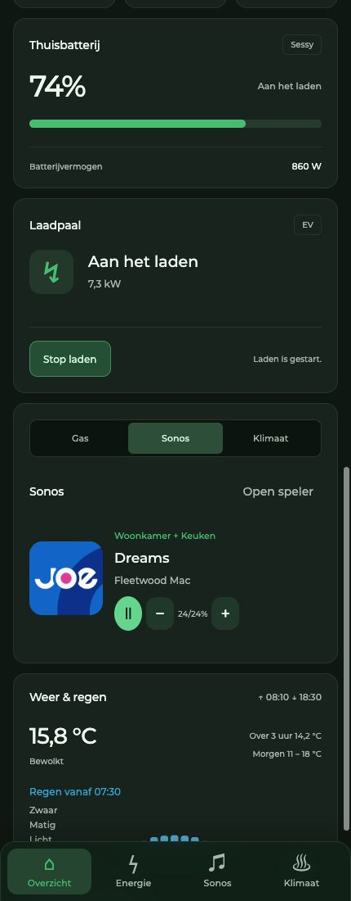
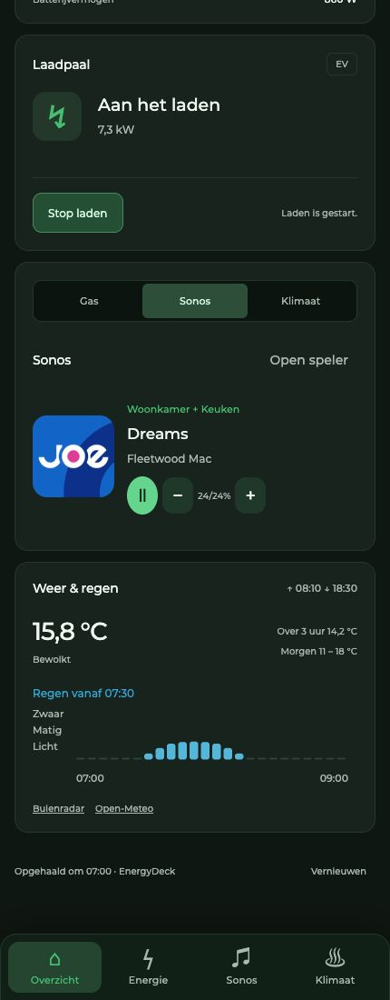

# EnergyDeck

<p align="center">
  
  &nbsp;
  
  &nbsp;
  
</p>

EnergyDeck is an open-source energy and smart home dashboard for **Homey Pro**, available on **ELECROW CrowPanel Advance 5.0" and 7.0"** ESP32-S3 touch displays and as an installable **mobile web app / PWA**. The display uses [ESPHome](https://esphome.io/) and [LVGL](https://lvgl.io/); the web app runs independently in a small Docker container.

Both versions connect directly over your local network to Homey and Sonos. They share household features, units, status colors and control behavior, with a responsive web layout for phones and larger screens. The web app does not require an ESP32 display.

---

## Features

- **Dynamic Electricity Prices:** 92/96/100 quarter-hour price bars for today and tomorrow, including daylight-saving transitions, daily minimum and maximum, and automatic identification of the cheapest consecutive 3-hour window. Calculates all-in household electricity prices (energy tax, VAT, and supplier fee).
- **Energy History:** Five-minute electricity power and gas-rate lines for today from Homey Insights, with missing-data gaps and independent refresh. See [setup and calculation](docs/ENERGY-HISTORY.md).
- **Solar & Net Power:** Live solar generation, net grid import/export power with direction indicators, and daily solar peak and total yield.
- **Home Battery (Sessy):** Live state of charge (SoC %), charge/discharge power, and operational status.
- **Sessy price control:** [Active rolling charge/hold/discharge planning](docs/SESSY-PRICE-PLAN.md#active-measured-control-25-october-2026) in the existing Homey Flow, using measured household/EV history, current battery and P1 readings, a confirmed phase limit, EV protection and 1 kW grid top-up. Both displays and web distinguish measured SoC, expected strategy and control deviations. The former [17:00 reserve controller](docs/SESSY-READY-BY-17.md) remains available through exact rollback.
- **Forward battery plan (shadow):** Optional [price-aware charge/hold/discharge proposals](docs/SESSY-PRICE-PLAN.md#implemented-shadow-rollout) across evening and morning peaks, with EV protection and a separate yellow sunshine forecast up to 36 hours. The home price chart shows one strategy timeline with measured Homey Insights SoC before now and a dashed SoC forecast after now, on its own percentage scale, aligned to the displayed price window, with a short color legend. Battery cards summarise the next transition instead of repeating the timeline. Both clients retain measured SoC; tapping the home battery card opens aligned price and planned battery-power charts with time selection on display and web. Provisional demand/headroom assumptions are labelled, and the existing controller remains active until calibration and reviewed activation.
- **EV charging proposal:** [Separate price-based daytime and overnight windows](docs/EV-CHARGE-PROPOSAL.md), aligned with the price/battery graph on web and ESP. Read-only proposals need no vehicle SoC or daily input; the charger card shows the current or next window.
- **EV Smart Charging:** Real-time go-eCharger connection and charging status, with one-touch button to trigger your Homey smart charging Flow.
- **Direct Local Sonos Player:** Zero-cloud UPnP control on port 1400 directly to Sonos speakers. Features both a compact dashboard card and a full-screen player page with embedded high-resolution station artwork (e.g. Joe, Qmusic, Sky Radio, Radio 538, NPO Radio 2), volume controls, household room grouping, and a 4-row favorites grid.
- **Automatic Overview Cards:** Sonos during playback, otherwise Climate during Evohome heat demand, otherwise Gas. Manual selections remain usable until this automatic priority changes or five minutes pass without input.
- **Multi-room Climate:** All 9 Evohome zones with measured/target temperatures and heat-demand highlights on the dashboard and Climate page.
- **Local Weather & Rain Radar:** 2-hour Buienradar precipitation graph and 3-hour Open-Meteo temperature outlook.
- **Automatic Night Dimming:** Time-based backlight dimming (e.g. 23:00 to 07:00) with instant touch-to-wake.
- **Desktop Simulator:** Test and preview the exact UI on macOS or Linux with live data before touching hardware.
- **Direct Live Updates:** Both display sizes and the simulator subscribe directly to Homey changes, with periodic reads as a fallback. The displays work independently of the web server. See [realtime transport and verification](docs/HOMEY-REALTIME.md).
- **Mobile Web App / PWA:** The energy dashboard, Insights graphs, local Sonos player with favorites and grouping, Evohome climate, weather/rain and charging Flow control on your phone, in one Docker container. Includes access-code login and server-side device credentials. See [web setup and security](docs/WEB.md).

---

## Mobile Web App / PWA

Use Overview, Energy, Sonos and Climate on your phone, tablet or computer. The web app follows the display's Montserrat typography, dark palette, smart net/gas/solar-battery meters, signed power arcs, price comparison and nine-zone Evohome view. Sonos favorites, room grouping and charging controls are included. Climate remains read-only, with thermostat control through Homey.

The desktop overview places prices and charging in two-thirds/one-third columns. Below them, stacked daily totals occupy one third beside a two-thirds weather panel, followed by full-width home controls. On phones, prices, battery, EV, totals, home controls and weather follow the document order. The climate overview shows up to four rooms with heat demand first; the dedicated climate page retains every configured room. Rain and sunshine share one compact forecast heading.

### Screenshots

These are actual mobile-browser captures of the PWA interface at 430×1100, using **simulated demo data only**. They contain no household readings, private addresses, device IDs or credentials. Click an image to view it at full size.

| Overview | Energy | Sonos | Climate |
| :---: | :---: | :---: | :---: |
| <a href="docs/screenshots/pwa-overview.jpg"></a> | <a href="docs/screenshots/pwa-energy.jpg"></a> | <a href="docs/screenshots/pwa-sonos.jpg"></a> | <a href="docs/screenshots/pwa-climate.jpg"></a> |

<details>
<summary>More screenshots: battery, EV charging and weather</summary>

The charging state below is simulated; no real charging Flow was triggered.

| Battery & EV charging | Weather & rain |
| :---: | :---: |
| <a href="docs/screenshots/pwa-charging.jpg"></a> | <a href="docs/screenshots/pwa-weather.jpg"></a> |

</details>

### Run locally

Install **Node.js 22 or newer**, configure the repository `.env` with your Homey/Sonos settings and a random six-digit PIN, then run:

```sh
# Generate a six-digit PIN and save it as ENERGYDECK_WEB_ACCESS_CODE in .env.
node -e "console.log(require('node:crypto').randomInt(1000000).toString().padStart(6, '0'))"
./run.sh web
```

Open the printed URL, normally `http://127.0.0.1:8080`, and enter your six-digit PIN. The launcher installs pinned dependencies when needed and handles local HTTP settings without changing `.env`. Stop with Ctrl+C. `./web/run.sh` is equivalent; `./run.sh` without `web` still starts the display simulator.

### Run with Docker and install on your phone

On an internal server that can reach Homey and your Sonos speakers, configure `.env` using the [web setup guide](docs/WEB.md), then start:

```sh
docker compose up -d --build
```

For phone access through your HTTPS reverse proxy or Cloudflare Tunnel, set the exact public origin and keep secure cookies enabled:

```dotenv
ENERGYDECK_WEB_ORIGIN=https://energydeck.example.com
ENERGYDECK_WEB_SECURE_COOKIE=true
```

The main `compose.yaml` publishes the web app directly with `ports`:

```yaml
ports:
  - "${ENERGYDECK_WEB_BIND_ADDRESS:-0.0.0.0}:${ENERGYDECK_WEB_PUBLISHED_PORT:-65000}:8080"
```

Open **`http://YOUR-NAS-IP:65000`** for direct NAS access. The default mapping is
**65000 on the NAS → 8080 inside the container**, on all NAS interfaces. Set
`ENERGYDECK_WEB_BIND_ADDRESS=127.0.0.1` for host-only access or change
`ENERGYDECK_WEB_PUBLISHED_PORT` if 65000 is already occupied. No additional Compose
file is needed. The local `./run.sh web` preview still uses port 8080.

For direct HTTP on a trusted LAN, follow the cookie settings in the
[web setup guide](docs/WEB.md#start-on-a-trusted-home-network). Coolify can also
route an HTTPS domain to service `web` on **internal port 8080**, using external
HTTPS port 443. Replace any old `8080:8080` mapping with the mapping above and
redeploy; see [Coolify setup](docs/WEB.md#coolify-deployment).

Homey and Sonos credentials stay on the server. Sign in with the household PIN on the login screen; never put it in a URL.

Open the HTTPS address on your phone and use the browser's **Add to Home Screen / Install app** option where supported. The PWA has its own favicon and phone icons and opens in standalone mode. Offline launch can show the app shell; private readings and device controls require a connection and are not cached by the service worker.

See [web setup, security and ESP parity](docs/WEB.md) for all configuration, permissions and verification details. Hardware backlight dimming and flashing apply to the physical display.

---

## Supported Hardware

| Model | Screen Size | Resolution | Part Number | Flash Target |
| :--- | :--- | :--- | :--- | :--- |
| **CrowPanel Advance 5.0"** | 5.0 inch IPS | 800 x 480 | `DIS02050A001` | `./flash.sh` |
| **CrowPanel Advance 7.0"** | 7.0 inch IPS | 800 x 480 | `DIS02170A` | `./flash.sh 7` |

Both hardware models share the same ESP32-S3 processor, 8 MB PSRAM, 16 MB flash, GT911 capacitive touch controller, and I²C backlight protocol.

---

## Quick Start & Installation

### Step 1: Prerequisites

For the display and Homey discovery tools, install **Python 3.10+** and **Git**. The web app can instead run with **Docker Compose**, or **Node.js 22+** for local use; see [Mobile Web App / PWA](#mobile-web-app--pwa).

On macOS (required only if you want to run the local desktop simulator):
```sh
brew install sdl2 libsodium
```

### Step 2: Clone & Configure Environment

Clone the repository and copy the example environment configuration:

```sh
git clone https://github.com/markm/energydeck.git
cd energydeck
cp .env.example .env
```

For the physical display, open `.env` in your text editor and fill in your Wi-Fi credentials (not needed for the web app):

```dotenv
ENERGYDECK_WIFI_SSID=your-wifi-name
ENERGYDECK_WIFI_PASSWORD=your-wifi-password
```

### Step 3: Connect Homey & Auto-Discover Devices

1. Open [Homey Web App](https://my.homey.app/) and sign in.
2. Go to **Settings → API Keys** and click **New API Key**.
3. Name it `EnergyDeck` and select the required permissions below (Flow-start access is only needed for charging control):
   - **Devices — Read only** (`homey.device.readonly` / *Apparaten weergeven*)
   - **Flows — Read only** (`homey.flow.readonly` / *Flows weergeven*)
   - **Flows — Start** (`homey.flow.start` / *Flows starten*)
   - **Logic / Variables — Read only** (`homey.logic.readonly` / *Variabelen weergeven*)
   - **Location — Read only** (`homey.geolocation.readonly` / *Locatie weergeven*)
4. Copy the API key and add your Homey IP and key to `.env`:
   ```dotenv
   HOMEY_ADDRESS=http://192.168.1.100
   HOMEY_TOKEN=your-homey-api-key
   ```
5. Run the interactive discovery tool:
   ```sh
   ./homey-setup.sh
   ```
   This wizard scans your Homey for Sessy batteries, HomeWizard P1 meters, solar inverters, EV chargers, and other devices, and outputs device IDs to add to your `.env`. Climate uses only EvoTouch/Evohome controller and zone IDs; see the [Climate setup](docs/CLIMATE.md).

6. **Sync dynamic energy prices:** In the Homey Web App, go to **HomeyScript**, create a new script named `EnergyDeck Prices`, and paste the contents of [`homeyscript/energydeck-prices.js`](homeyscript/energydeck-prices.js). Create a Flow that runs this script every hour or when electricity prices update.

The optional Sessy controller is installed as **Sessy - Laadplan**, with a read-only
manual **Run** preview and the existing Flow as the only actuator path. See
[active measured control and rollback](docs/SESSY-PRICE-PLAN.md#active-measured-control-25-october-2026).

### Step 4: Configure Sonos (Optional)

EnergyDeck connects directly to your Sonos speakers via local HTTP/UPnP on port 1400. You only need to specify one speaker address (bootstrap seed); EnergyDeck automatically queries it to discover the entire household zone topology and all other rooms.

In `.env`:
```dotenv
SONOS_BOOTSTRAP_ADDRESS=http://192.168.1.50:1400
SONOS_BOOTSTRAP_FALLBACK_ADDRESS=http://192.168.1.51:1400
```

*(Tip: Set a static DHCP reservation in your router for your bootstrap speaker).*

### Step 5: Preview in Simulator (Optional)

Test your configuration on your computer before flashing:

```sh
./run.sh
```

The script automatically prepares a local Python virtual environment, installs ESPHome, and launches the live interactive LVGL simulator. Stop it with `Ctrl+C`.

---

## Flashing Your CrowPanel Display

### 1. Connect over USB

Connect your CrowPanel display to your computer using a USB-C data cable (note: charge-only cables will power the screen but cannot transfer data).

**macOS Serial Driver (CH34x):**
The CrowPanel uses a WCH CH34x USB-to-serial chip. If `/dev/cu.wchusbserial...` does not appear in `ls /dev/cu.*`, download and install the official [WCH CH34x driver for macOS](https://www.wch.cn/downloads/CH34XSER_MAC_ZIP.html).
After installation, open **System Settings → General → Login Items & Extensions → Driver Extensions** and enable **CH34xVCPDriver / WCH**.

### 2. Enter Download Mode

To put the display in flashing mode:
1. Hold down the **BOOT** button on the back of the CrowPanel.
2. Press and release the **RST** button while continuing to hold **BOOT**.
3. Release the **BOOT** button after 1 second.

### 3. Back Up Factory Firmware (Recommended)

Before flashing for the first time, create a full 16 MB flash backup of your factory firmware:

```sh
./.venv/bin/python scripts/backup_factory_flash.py \
  --port /dev/cu.wchusbserial110 \
  --baud 115200 \
  --output backups/crowpanel-factory-backup.bin
```

*(Replace `/dev/cu.wchusbserial110` with your port if different).*

### 4. Flash EnergyDeck

Run the flash script matching your display size:

#### For the 5-inch Display:
```sh
./flash.sh
```
*(Optionally specify a custom serial port: `./flash.sh /dev/cu.wchusbserial110`)*

#### For the 7-inch Display:
```sh
./flash.sh 7
```
*(Optionally specify a custom serial port: `./flash.sh /dev/cu.wchusbserial110 7`)*

The script reads `.env`, builds the firmware with ESPHome, uploads it via `esptool`, and displays the live boot logs.

For standalone target builds, also inspect the generated Xtensa startup stack
before upload:

```sh
.venv/bin/python scripts/check-display-stack.py esphome/.esphome/build/energydeck
.venv/bin/python scripts/check-display-stack.py esphome/.esphome/build/energydeck-7
```

The check reserves at least half the configured loop stack for callers/callees.
An OTA transfer succeeding does not prove that the new firmware boots; a large
by-value global initializer can compile successfully and exhaust the startup stack.

---

## Over-The-Air (OTA) Updates

Once flashed, the display can be updated wirelessly over Wi-Fi without connecting a USB cable:

- **5-inch display:** `.venv/bin/esphome run esphome/energydeck-crowpanel.yaml --device energydeck.local`
- **7-inch display:** `.venv/bin/esphome run esphome/energydeck-crowpanel-7.yaml --device energydeck-7.local`

---

## Display Navigation & Controls

| Gesture / Tap Target | Action |
| :--- | :--- |
| **Tap Price Graph Header** | Switch between *Today* and *Tomorrow* price forecasts |
| **Tap Energy / Solar Ring** | Toggle between daily energy use and year-to-date totals |
| **Tap Gas / Sonos / Climate** | Select that card on the dashboard; tap the already visible card's button again to open its detail page (Gas opens Energy). The PWA card buttons behave the same way. |
| **Tap Compact Sonos Card** | Open full-screen Sonos player with artwork and favorite stations |
| **Sonos Player Back Button** | Return to the main dashboard |
| **Touch Display during Night** | Wake screen to full daytime brightness for 30 seconds |

---

## Automatic Night Dimming

EnergyDeck includes hardware-level backlight dimming to avoid lighting up a dark room at night:

```dotenv
# Backlight brightness (0 is maximum brightness, 245 is minimum/dimmed)
ENERGYDECK_BACKLIGHT_DAY_BRIGHTNESS=48
ENERGYDECK_BACKLIGHT_NIGHT_BRIGHTNESS=160

# Night schedule (24-hour format)
ENERGYDECK_BACKLIGHT_NIGHT_START_HOUR=23
ENERGYDECK_BACKLIGHT_NIGHT_END_HOUR=7

# Wake duration in seconds when touched at night
ENERGYDECK_BACKLIGHT_WAKE_DURATION_S=30
```

---

## Documentation Links

- [Mobile Web App / PWA](docs/WEB.md) — Docker and local startup, HTTPS, access-code security, phone installation and display parity.
- [Energy History](docs/ENERGY-HISTORY.md) — Homey Insights setup, five-minute graphs and calculation rules.
- [Smart Header and Detail Pages](docs/SMART_HEADER.md) — Gauge behavior and Energy/Climate detail views.

- [Sonos Integration Architecture](docs/SONOS.md) — UPnP/SOAP protocol details, queue guards, embedded station artwork, and zero-cloud direct control.
- [Homey Pro Integration](docs/HOMEY.md) — Local Web API token, rate limits, device schemas, and price bridging.
- [Multi-room Climate Setup](docs/CLIMATE.md) — Configuring an EvoTouch controller and up to 9 Evohome zones.
- [Rain Radar & Weather](docs/RAIN.md) — Buienradar 2-hour rain forecast and Open-Meteo temperature integration.
- [Performance & Memory Architecture](docs/PERFORMANCE.md) — PSRAM heap routing, LVGL partial rendering, and benchmark diagnostics.
- [Development & Contribution Guidelines](AGENTS.md) — Working agreements, code style, and Git commit policies.

---

## License

This project is open-source under the MIT License.

The bundled Montserrat font uses the [SIL Open Font License](web/public/fonts/OFL.txt). Station logos belong to their respective broadcasters.

## Privacy when sharing the repository

Keep household names, Wi-Fi credentials, location, Homey IDs and Sonos bootstrap
addresses in the ignored `.env`, never in source files or documentation. The
tracked defaults and examples are synthetic; configure your own Sonos addresses
before use. Display room names can be overridden with
`HOMEY_ROOM_THERMOSTAT_1_NAME` through `HOMEY_ROOM_THERMOSTAT_9_NAME`; the web app
uses the same settings. Sonos discovers device identities from network topology.
Historical hardware notes omit private IP and MAC addresses. Public screenshots
use demo data (see `docs/screenshots/README.md`).

Use your Git hosting account's noreply email for commits. Removing private data
from a file does not remove earlier versions: published history and existing
clones must be handled separately when sanitizing a repository. Never distribute
local `.env`, firmware builds, flash backups or an unsanitized Git recovery bundle.

The local privacy cleanup rewrote earlier commits. Hardware notes retain their
original commit labels as historical provenance; those labels may no longer
resolve in the sanitized history. Replacing an already published history requires
an explicit coordinated force push; fetching an unsanitized remote can bring
old private data back into a local clone.
